# 🔐 Awesome User Provisioning & Directory Services

  <strong>Curated Directory of Identity Lifecycle Automation, SCIM 2.0 Provisioning, LDAP/AD Directory Services & Self-Hosted IAM Solutions</strong>

---

## 📑 Table of Contents

- [🔍 Overview & Core Concepts](#-overview--core-concepts)
- [📊 Sector Overview & Market Dynamics](#-sector-overview--market-dynamics)
- [🏢 SaaS & Hosted Identity Platforms](#-saas--hosted-identity-platforms)
- [💻 Open-Source GitHub Projects](#-open-source-github-projects)
- [📈 Star History](#-star-history)
- [🤝 How to Contribute](#-how-to-contribute)
- [💖 Support & Sponsorship](#-support--sponsorship)
- [⚖️ Disclaimer & Security Advisory](#-disclaimer--security-advisory)

---

## 🔍 Overview & Core Concepts

**User Provisioning & Directory Services** forms the mission-critical foundation of modern **Identity & Access Management (IAM)** and **Identity Governance & Administration (IGA)** architectures. These solutions automate the end-to-end **Joiner-Mover-Leaver (JML)** lifecycle across multi-cloud and hybrid enterprise environments:

- 🟢 **Joiner (Onboarding)**: Seamlessly creates user accounts, provisions mailboxes, and assigns baseline role entitlements across downstream SaaS applications immediately upon HR record creation in systems like Workday, BambooHR, or Rippling.
- 🔄 **Mover (Role Transition)**: Automatically detects team, departmental, or geographical role modifications and synchronizes fine-grained group memberships, license tiers, and dynamic directory attributes to maintain least privilege.
- 🔴 **Leaver (Offboarding / Deprovisioning)**: Instantly revokes Active Directory / LDAP access, disables SSO sessions, invalidates OAuth access tokens, and archives cloud licenses to mitigate orphaned account vulnerabilities and data exfiltration risks.
- ⚡ **SCIM 2.0 Standard (RFC 7643 / RFC 7644)**: Leverages standard System for Cross-domain Identity Management schemas and RESTful APIs to automate bi-directional user and group synchronization between identity providers (IdPs) and service providers (SPs).

---

## 📊 Sector Overview & Market Dynamics

> 📈 **Market Size & Trajectory**: The global User Provisioning, Directory Services, and Identity Governance & Administration (IGA / IAM) sector is estimated at **$18.5 Billion in 2024** and projected to surpass **$42 Billion by 2031**, expanding at a robust compound annual growth rate (**CAGR**) of **~13.5%**. Market growth is fueled by mandatory Zero-Trust enterprise architectures, decentralized workforce models, SaaS sprawl, and strict compliance mandates (SOC 2, ISO 27001, NIS2, HIPAA, GDPR).
>
> 🧩 **Market Concentration & Competitive Dynamics**: The sector is **moderately fragmented with strong consolidation at the core identity and directory federation layer**. Incumbents such as Microsoft Entra ID and Okta maintain dominant enterprise market shares for identity federation, single sign-on (SSO), and core cloud directories. Concurrently, specialized domains—including enterprise access governance (SailPoint), fine-grained application access request workflows (Lumos), unified HR/IT employee graph orchestration (Rippling), and privileged access management (CyberArk)—fuel a dynamic and highly competitive best-of-breed software landscape.

---

## 🏢 SaaS & Hosted Identity Platforms

The table below catalogs leading commercial SaaS platforms for identity provisioning, directory synchronization, and user lifecycle management, ranked in descending order of company scale (market capitalization or latest enterprise valuation).

| Company / Product 🏷️ | Market Cap / Valuation 💰 | Starting Tier Pricing 💵 | Free Tier / Free Trial Limits ⏱️ | Key Provisioning & Directory Capabilities 🎯 |
| :--- | :--- | :--- | :--- | :--- |
| **[Microsoft Entra ID](https://www.microsoft.com/en-us/security/business/microsoft-entra)** | **~$3.1 Trillion** *(Market Cap)* | **$3.00** /user/month *(Entra ID P1)*; P2 at $6.00 /user/month | **Free Forever Plan** (up to 50,000 objects/directory; supports SSO for up to 10 apps per user, basic directory sync) + **30-day Free Trial** for P2 premium features | Native Azure/M365 integration, HR-driven Lifecycle Workflows (joiner/mover/leaver), inbound/outbound SCIM 2.0 provisioning, and dynamic security group assignment. |
| **[Atlassian User Management](https://www.atlassian.com/)** | **~$48 Billion** *(Market Cap)* | **$7.00** /user/month *(Atlassian Cloud Guard Standard)* | **Free Forever Plan** for up to 10 users across Jira & Confluence + **30-day Free Trial** for Atlassian Guard and Cloud Enterprise | Centralized user and group directory management across Jira, Confluence, and Bitbucket; supports SCIM provisioning from external IdPs, SAML SSO, and directory audit trails. |
| **[Okta Lifecycle Management](https://www.okta.com/)** | **~$15 Billion** *(Market Cap)* | **$4.00** /user/month *(Okta Lifecycle Management)*; SSO starts at $2.00 /user/month (annual contract min. $1,500/yr) | **30-day Free Trial** (unlimited users and full access to Okta Integration Network and SCIM workflows during trial) | Automated joiner-mover-leaver workflows, pre-built SCIM integrations with 7,000+ cloud applications, HR-driven provisioning (Workday, BambooHR), and attribute-level mapping. |
| **[Rippling](https://www.rippling.com/)** | **~$13.5 Billion** *(Valuation)* | **$8.00** /employee/month *(base HR platform + App Management module add-on)* | **14-day Free Trial** (by sales demo qualification; access to sandbox directory environment) | Single Employee Graph unifying HR data with automated app provisioning/deprovisioning across 650+ apps, automated role-based permission grouping, and hardware provisioning. |
| **[CyberArk Identity](https://www.cyberark.com/)** | **~$11.5 Billion** *(Market Cap)* | **$3.00** /user/month *(CyberArk Identity SSO & User Management)* | **30-day Free Trial** (up to 50 users with full access to identity federation, MFA, and automated user provisioning) | Integrated directory services with automated lifecycle management, inbound/outbound SCIM provisioning, privileged account governance, and zero-trust policy enforcement. |
| **[SailPoint](https://www.sailpoint.com/)** | **~$7.1 Billion** *(Acquisition Valuation)* | **$4.00** /user/month *(SailPoint Identity Security Cloud Standard)* | **30-day Free Trial** (interactive sandbox access available through guided sales engagement) | Enterprise Identity Governance and Administration (IGA) with automated lifecycle management, role discovery and mining, access certification, and compliance reporting across hybrid directories. |
| **[JumpCloud](https://jumpcloud.com/)** | **~$2.6 Billion** *(Valuation)* | **$9.00** /user/month *(Core Directory tier)*; Platform tier at $15.00 /user/month | **Free Forever Plan** (up to 10 users and 10 devices with all platform features included forever; 10 days of premium chat support) + **30-day Free Trial** | Cloud Directory-as-a-Service unifying user identity, device management (Mac, Windows, Linux), Cloud LDAP, Cloud RADIUS, SAML SSO, and SCIM automated provisioning. |
| **[OneLogin](https://www.onelogin.com/)** | **~$2.0 Billion** *(Acquisition Valuation via One Identity)* | **$4.00** /user/month *(Advanced Identity with Provisioning)* | **30-day Free Trial** (unlimited users and full access to SCIM app connectors and directory synchronization during trial) | Automated real-time provisioning and deprovisioning via SCIM, Active Directory / LDAP bi-directional synchronization, and entitlement-based role assignment. |
| **[Lumos](https://www.lumos.com/)** | **~$1.0 Billion** *(Valuation)* | **$3.50** /user/month *(App Governance & Access Requests)* | **14-day Free Trial** (free guided trial with connectable sandbox integrations) | Self-service AppStore for employee access requests, automated time-bound role provisioning via SCIM connectors, and automated license deprovisioning. |
| **[BetterCloud](https://www.bettercloud.com/)** | **~$700 Million** *(Acquisition Valuation)* | **$3.00** /user/month *(BetterCloud Core SaaS Management)* | **14-day Free Trial** (full-featured access to automated onboarding/offboarding workflow engine for connected SaaS apps) | Multi-SaaS user lifecycle management and orchestration, automated offboarding checklists across disparate directories, policy-driven security remediation, and audit logging. |

---

## 💻 Open-Source GitHub Projects

The table below curates the premier open-source solutions for user provisioning, LDAP/AD directory services, and self-hosted IAM. The table is ordered by GitHub star count in descending order.

| Project / Repository 📦 | Stars ⭐ | License 📜 | Description & Provisioning Capabilities 🎯 |
| :--- | :--- | :--- | :--- |
| **[Keycloak](https://github.com/keycloak/keycloak)** |  | Apache-2.0 | The industry standard open-source IAM and directory broker. Offers OpenID Connect, OAuth 2.0, SAML 2.0, LDAP/Kerberos federation, user registration/lifecycle management, and SCIM 2.0 server capabilities for receiving directory accounts from Okta, Entra ID, or HR systems. |
| **[Authelia](https://github.com/authelia/authelia)** |  | Apache-2.0 | Lightweight authentication and authorization server acting as an identity portal for reverse proxies. Integrates with LDAP/file user directories, supports 2FA (TOTP/WebAuthn), and enforces fine-grained access rules for self-hosted apps. |
| **[Authentik](https://github.com/goauthentik/authentik)** |  | GPL-3.0 | Modern open-source Identity Provider focused on flexibility and automation. Includes built-in SCIM 2.0 service provider (inbound) and client (outbound) provisioning, LDAP outpost, user lifecycle event flows, enrollment stages, and multi-protocol SSO. |
| **[ZITADEL](https://github.com/zitadel/zitadel)** |  | Apache-2.0 | Cloud-native identity platform built with event-sourcing architecture. Provides multi-tenancy, self-service user onboarding, fine-grained RBAC/ABAC role delegation, audit trails, and automated user management via gRPC/REST APIs. |
| **[Casdoor](https://github.com/casdoor/casdoor)** |  | Apache-2.0 | Feature-dense, UI-first IAM platform built with Go and React. Features built-in SCIM 2.0 server endpoints, a built-in virtual LDAP server, multi-tenant RBAC, and bi-directional syncers with Active Directory, Okta, Google Workspace, and SQL databases. |
| **[Ory Kratos](https://github.com/ory/kratos)** |  | Apache-2.0 | API-first, cloud-native user management and identity administration system. Implements self-service user registration, profile management, account verification, recovery flows, MFA, and headless integration for custom directory architectures. |
| **[LLDAP](https://github.com/lldap/lldap)** |  | GPL-3.0 | Lightweight, low-overhead LDAP server with a modern web administration console. Ideal for home labs and small organizations wanting straightforward user and group management without full Active Directory/OpenLDAP complexity. |
| **[GLAuth](https://github.com/glauth/glauth)** |  | MIT | Minimalist, lightweight LDAP authentication and directory server written in Go. Supports static configuration files, SQLite/MySQL/PostgreSQL backends, REST API endpoints, and containerized deployments. |
| **[FreeIPA](https://github.com/freeipa/freeipa)** |  | GPL-3.0 | Complete open-source enterprise identity and domain controller for Linux/UNIX environments. Combines 389 Directory Server (LDAP), MIT Kerberos, NTP, DNS, Dogtag Certificate System, and SSSD with bi-directional Active Directory cross-forest trust. |
| **[OpenIdentityPlatform OpenAM](https://github.com/openidentityplatform/openam)** |  | CDDL-1.0 | Open-source enterprise Access Management and SSO solution derived from Sun OpenSSO/ForgeRock OpenAM. Provides centralized identity brokering, directory federation, entitlements, and self-service registration. |
| **[WSO2 Identity Server](https://github.com/wso2/product-is)** |  | Apache-2.0 | Enterprise-grade IAM and CIAM platform managing over 1B identities globally. Provides robust bi-directional SCIM 2.0 provisioning, inbound/outbound user identity synchronization, adaptive MFA, and delegated administration. |
| **[OpenLDAP](https://github.com/openldap/openldap)** |  | OpenLDAP | The foundational reference implementation of the Lightweight Directory Access Protocol (LDAP). Serves as the central directory store for identities, groups, and permissions across millions of enterprise and open-source systems. |
| **[midPoint](https://github.com/Evolveum/midpoint)** |  | EUPL-1.2 | Comprehensive open-source Identity Governance and Administration (IGA) and provisioning engine. Automates joiner-mover-leaver lifecycles, role catalogs, access certifications, and bi-directional directory synchronization via ConnId connectors and SCIM. |
| **[Apache Syncope](https://github.com/apache/syncope)** |  | Apache-2.0 | Top-level Apache project for digital identity management and enterprise provisioning. Features bi-directional identity reconciliation, ConnId connector architecture, end-user self-service, and role entitlement synchronization. |
| **[389 Directory Server](https://github.com/389ds/389-ds-base)** |  | GPL-3.0 | Hardened, enterprise-class LDAP directory server developed by Red Hat (upstream of Red Hat Directory Server). Built for high-volume replication, multi-master clustering, and high-performance identity storage. |
| **[FusionDirectory](https://github.com/fusiondirectory/fusiondirectory)** |  | GPL-2.0 | Web-based directory administration and identity management console for OpenLDAP. Offers fine-grained ACLs, role delegation, and an event-driven trigger system to run automated lifecycle scripts when accounts are created, updated, or removed. |
| **[Apache Directory Studio](https://github.com/apache/directory-studio)** |  | Apache-2.0 | Complete directory tooling platform and GUI browser for LDAP administration. Features full schema browser, LDIF editor, batch entry management, and access control testing across any standard LDAP server. |
| **[OpenIdentityPlatform OpenIDM](https://github.com/openidentityplatform/openidm)** |  | CDDL-1.0 | Open-source Identity Management and Provisioning framework derived from ForgeRock OpenIDM. Automates user provisioning, password resets, role-based access assignment, and bi-directional directory synchronization across systems. |
| **[GoSCIM](https://github.com/arturoeanton/goscim)** |  | MIT | Ultra-fast, lightweight RFC 7643/7644 compliant SCIM 2.0 server implemented in Go. Features dynamic schema loading via JSON, fine-grained attribute-level permissioning, ETag concurrency controls, and high-throughput Couchbase storage integration. |
| **[Canaille](https://github.com/yaal-coop/canaille)** |  | MIT | Lightweight Python-based identity and authorization management tool. Provides user profile administration, OpenID Connect authentication, and SCIM provisioning with first-class support for SQL and OpenLDAP backends. |
| **[Axia](https://github.com/Nelsar/Axia)** |  | Apache-2.0 | Self-hosted LDAP administration web console and REST API for Active Directory and OpenLDAP. Features user, group, OU, and computer management with role-based access controls and detailed audit logging. |

---

## 📈 Star History

---

## 🤝 How to Contribute

We welcome additions, corrections, and improvements from identity architects, IT administrators, security engineers, and open-source contributors!

1. 🍴 **Fork the repository** to your GitHub account.
2. 🌿 **Create a feature branch**: `git checkout -b add-provisioning-tool`.
3. 📝 **Add or update entries**:
   - For SaaS: Include starting tier pricing, free plan / trial details, and company scale (market cap / valuation).
   - For Open-Source: Include the official GitHub repository link, license, and verified GitHub star badge linked to stargazers.
4. 🚀 **Submit a Pull Request** with a concise description and official reference links.

Star the repo if you find it helpful! ⭐

---

## 💖 Support & Sponsorship

Thank you for visiting and supporting the **Awesome User Provisioning & Directory Services** project! 🎉

If you find this curated directory valuable for your identity architecture, IT administration, or security compliance workflows, please consider:
- ⭐ **Starring this repository** to help others discover it.
- 🍴 **Forking and sharing** it with fellow DevOps and IAM professionals.
- ☕ **Buying a coffee or sponsoring** future maintenance via the [GitHub Sponsors Dashboard](https://github.com/sponsors/ishandutta2007).

Your sponsorship and community contributions directly sustain the ongoing research, curation, and accuracy of this guide. Thank you! 🙌

---

## ⚖️ Disclaimer & Security Advisory

- ℹ️ This is a **community-curated** list maintained for informational and educational purposes; mention does not constitute commercial endorsement.
- 🔒 **Security Advisory**: User provisioning and directory services handle sensitive personal identity data and security credentials. Always ensure systems comply with applicable data protection regulations (GDPR, CCPA) and security standards (SOC 2, ISO 27001). Incomplete or erroneous deprovisioning workflows leave orphaned accounts that represent critical attack vectors for enterprise compromise.
- 📄 Verify license terms for individual open-source projects before commercial deployment.

---

  Made with ❤️ for identity architects, CISOs, IT administrators, DevOps engineers, and directory services teams worldwide.

